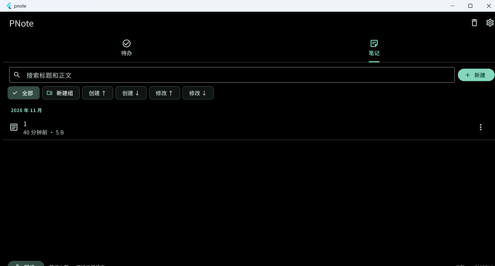
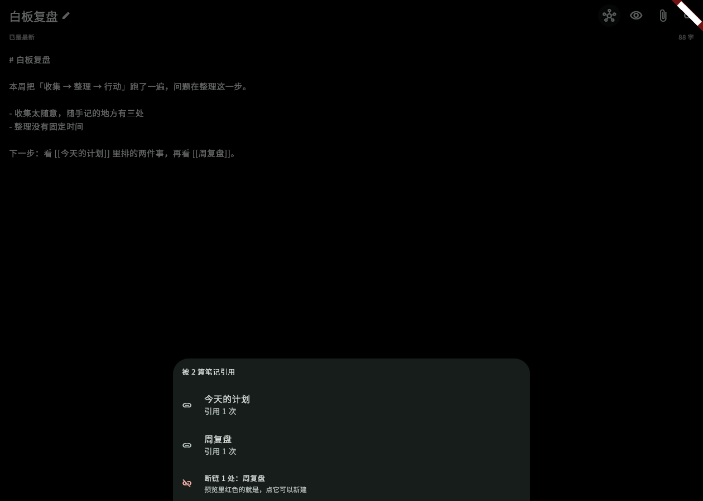
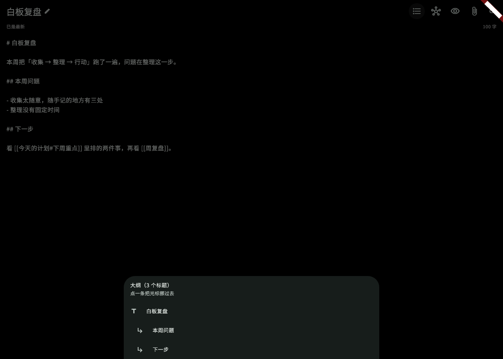

# PNote

[](https://github.com/ZhanJN/PNote/actions/workflows/ci.yml)
[](https://github.com/ZhanJN/PNote/releases/latest)

> 1.63.1（2026-11-28，编辑器三修）· 最新 Release 仍是 [v1.62.1](https://github.com/ZhanJN/PNote/releases/tag/v1.62.1)

一个纯局域网、无账号、无云端的极简待办 + 笔记应用。Flutter 编写，Windows 与 Android 共用一套代码，数据以「Markdown 文件 + SQLite」形式存在本地，两台设备连同一个 Wi-Fi 就能互相同步。

A local-first todo & note app: peer-to-peer sync over LAN, no account, no cloud, no server.

## 特性

- **待办**：两级分组、拖拽排序、多选、回收站、重复任务（日/周/月/年 + 自定义）、截止时间与精度（全天/精确到分钟）、提醒（单条 > 组默认 > 全局三层提前量）、逾期标红、时间切片与组视图
- **笔记**：一篇笔记 = 磁盘上一个 `.md` 文件（同名 `.assets/` 放图片附件），Markdown 渲染、编辑即存、搜索、`[[双链]]` 与 `#标题` 锚点跳转、反向链接、大纲、字数；笔记组是「视角」不是文件夹：一篇笔记只属于一个组、组可多级嵌套与折叠、组和笔记都能置顶、组清单随同步走；块状编辑器（标题/正文/列表/待办/引用/代码/分割线/图片/表格），支持加粗斜体删除线、`==高亮==`（含五种颜色）、`:::` 居左/中/右、插入图片与笔记引用，另可切到纯 Markdown 源码模式；列表可显示正文首行摘要，多空行在预览里保留；长按可整段框选、复制、剪切
- **同步**：手动一键同步，UDP 广播发现 + WebSocket 传输，全量交换 + HLC 冲突合并（后改的赢），多设备 mesh 传递，任务与笔记（含附件）都同步，删除/彻底删除会传播
- **账号名（同步分组）**：设置里给本机起个名字，**同名设备才互相同步**——用来把家里的设备和不相关的人分开；它不是注册账号，没有密码、没有服务器。另有一个内置名「公开同步」，选了就会和同一 Wi-Fi 下同样选了它的设备互相同步（界面会弹风险提示）
- **其他**：深色/浅色/跟随系统主题、减少动效开关、备份导出/导入、Android 前台服务保活

## 截图

| 笔记列表与视图条 | 编辑器与反向链接 | 大纲 |
|---|---|---|
|  |  |  |

## 技术要点

- **本地优先**：没有服务器、没有账号。任务存 `pnote.db`（SQLite），笔记就是普通文件，删掉 App 用记事本也能打开。
- **冲突解决**：自己实现的混合逻辑时钟（HLC）+ 逐字段 last-write-wins，比较键是 `(毫秒, 计数, 设备号)`；同一字段两设备都改过时，时钟大的赢，完全不看系统时间的先后。
- **同步协议**：`pnote-sync/8`（1.51 起多了 `account` 字段），发现用 UDP 47821（同时发定向广播与全网广播，另有网段扫描兜底），传输用 WebSocket 47822–47831（端口逐级回退），三帧交换 + 附件按 1 MB 分块。
- **删除语义**：任务删除写墓碑 `deleted_at` + 版本；笔记删除移到 `.trash/时间戳/`；「彻底删除」两者都有版本化记录（任务在 `purged` 表，笔记在 `.sync.json` 的 `purged`），因此会传播到其他设备。
- 细节见 [docs/ARCHITECTURE.md](docs/ARCHITECTURE.md) 与 [docs/SYNC-PROTOCOL.md](docs/SYNC-PROTOCOL.md)。

## 目录结构

```
lib/
  main.dart  app.dart         应用入口与根 Widget
  theme/                     主题、主题控制器
  data/                      SQLite：schema、DAO、重复规则、时间、备份
  notes/                     笔记文件层：读写、解析、渲染、组、排序、同步
  sync/                      发现、传输、HLC、合并、mesh、协议编解码
  platform/                  平台相关（通知、路径、设备名）
  ui/
    shell/                   顶栏 + 双页签骨架
    tasks/                   待办列表、行、菜单、分组对话框
    notes/                   笔记列表、编辑器、行、菜单
    trash/                   统一回收站（任务 / 笔记两页签）
    reminders/  settings/  devices/  common/
test/                        415 条单元/组件测试
tool/                        调试探针（发现、扫描、拨号、打包归档）
docs/                        架构、协议、变更记录、界面截图
```

## 开发环境

- Flutter 3.50+（Dart 3.14），Android SDK 36 / NDK 28 / JDK 17
- Windows：Visual Studio 2022（MSVC + Windows SDK）

```bash
flutter pub get
flutter test                 # 415 条
flutter analyze
flutter build windows --release
flutter build apk --release --split-per-abi
```

仓库根目录的五个 `.bat` 是双击即用的包装脚本（`run-windows` / `build-windows` / `build-android` / `install-android` / `pack-release`），会读取 `FLUTTER_HOME`、`ANDROID_HOME`、`JAVA_HOME`，未设置时用常见默认值并给出提示。

## 已知限制

- 只支持手动同步（划掉最近任务或息屏过久时，被拨号方可能还没准备好，需要两台都亮着）
- 明文传输、无认证，只在可信任的家庭局域网里使用；「账号名」只是同步分组名，不提供任何安全保证
- 两端必须同版本（协议主版本不符会被拒绝），同一账号名才同步
- 编辑器是「每段一个输入框」的块编辑器：跨段操作靠长按整段框选，不是系统级跨段光标；粘贴剪贴板图片、拖拽图片进窗口暂未支持
- 不做：协同编辑、云同步、注册/登录、加密备份、块级 ID

## 许可

MIT，见 [LICENSE](LICENSE)。
